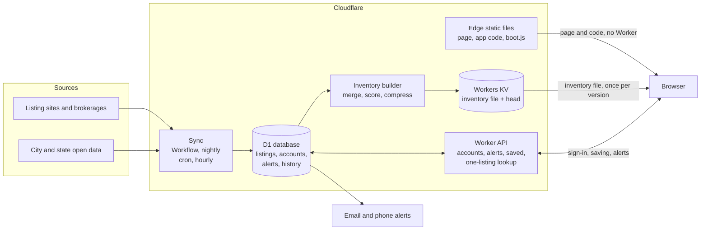
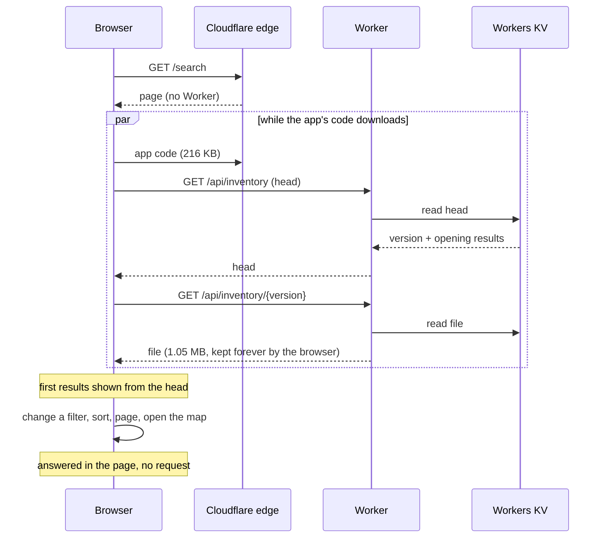
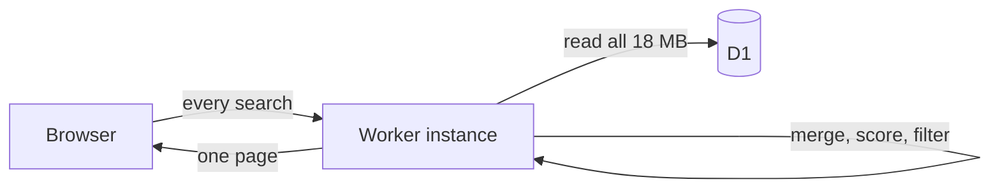
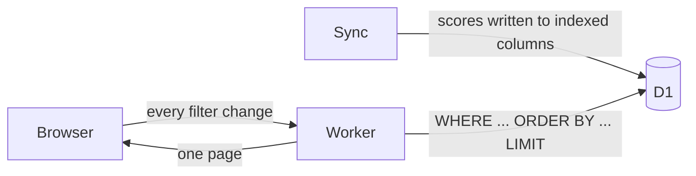
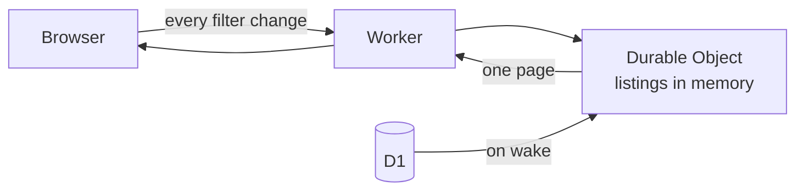
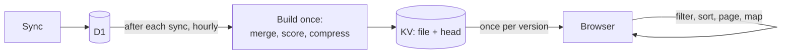

# Architecture

How Walkup is built, what was tried, and what each design measured. Diagrams render on GitHub.

- [The system today](#the-system-today)
- [What happens when someone searches](#what-happens-when-someone-searches)
- [Every design considered, with results](#every-design-considered-with-results)
- [Questions worth asking](#questions-worth-asking)
- [What would improve it further](#what-would-improve-it-further)

Related: [search.md](search.md) (the search decision in detail) and [../performance.md](../performance.md) (the
checks that stop a slowdown from shipping).

## The system today

| Part | What it does | Where |
|---|---|---|
| Sync | Reads each source, one at a time, and saves its listings | `server/sync-workflow.ts`, `server/nightly.ts` |
| D1 | The source of truth: listings as saved, accounts, alerts, rent history | `server/storage/` |
| Inventory builder | Merges and scores every listing once, writes one compact file | `server/inventory.ts` |
| Workers KV | Holds the file and its head, served from every Cloudflare location | binding `INVENTORY` |
| Edge static files | The page and the app's code, served without running the Worker | `web-build/`, `_headers` |
| Worker API | Everything personal or written: sign-in, saved apartments, alerts, billing | `server/routes/` |
| Browser | Downloads the file once, then searches it itself | `src/inventory-client.ts`, `src/answer.ts` |

## What happens when someone searches

A filter change after the file has arrived makes no request at all. The Worker is involved only in handing over
the file, and for anything personal.

## Every design considered, with results

All numbers are from the live site (`apartments.5thof6.com`) on 25–26 November 2026, with about 18,450 listings,
measured in a fresh phone-profile browser or with `curl` from a US cloud host. "Built" means it ran in
production; where a design was not built, the row says so and the numbers are the measured cost of its parts.

| | Design | Built? | First results | Each filter change | Data a visitor can take |
|---|---|---|---|---|---|
| A | Server filters in memory, reading listings per search | Yes (until 25 Nov) | 1.3–4.7 s | 1.3–4.7 s | One page per request |
| A2 | A, with one shared set of listings per server instance | Yes | 2.0–4.1 s cold, 0.4–0.6 s warm | same | One page per request |
| A3 | A2, plus stored answers for searches already run | Yes | 0.9–1.1 s | 0.3–3.4 s (slow whenever the search was new) | One page per request |
| **E** | **Publish one scored file; search in the browser** | **Yes (now)** | **0.5–0.8 s (1.2 s once in eight visits)** | **0.30–0.43 s, no request** | **Everything, in one file (own pages only)** |
| B | Filter in the database with indexes | No | est. 0.3–0.9 s | est. 0.2–0.8 s, one request each | One page per request |
| C | One always-warm instance (Durable Object) holding the listings | No | est. 0.3–0.9 s | est. 0.2–0.8 s, one request each | One page per request |
| D | A hosted search engine | No | est. 0.3–0.6 s | est. 0.2–0.5 s, one request each | One page per request |
| F | An always-on server outside Workers, listings in memory | No | est. 0.3–0.6 s | est. 0.1–0.3 s, one request each | One page per request |

Where the estimates come from, all measured:

- A request that only passes through the Worker (`/health`, no database): **0.13–0.73 s** to first byte. A file
  from the edge with no Worker (`/boot.js`): **0.14–0.16 s**. So any design with a request per filter change
  pays up to about 0.6 s for the Worker on top of the network, whatever language it is written in.
- One indexed database lookup through the Worker, end to end (`/api/listing/stored`): **0.40–0.56 s**. That is
  what a filter change would cost in designs B and C.
- The database is fast: filtering to New York, 1–2 bedrooms, under $3,000 and counting (1,668 matches) took
  **17 ms**; returning a page of 100 of them (90 KB) took **20 ms**; grouping every New York listing by
  neighborhood and size took **84 ms**.
- Loading and scoring every listing on a new instance: **2–3 s** (0.25–0.9 s waiting on the database, the rest
  computing), which is what A and A2 pay and what B, E and F avoid.

### A. Server filters in memory (the original)

- For: simple; nothing is exposed beyond a page of results.
- Against: Workers run many short-lived instances, and each new one read and scored everything first. Measured:
  1.3–4.7 s for a search. A2 and A3 softened it (0.4–0.6 s on a warm instance, 0.1 s for a repeated search) but a
  new search on a new instance still took 2–3 s, about half the time.

### B. Filter in the database (what most listing sites do, at their scale)

- For: a page per request, so the least data exposed; scales to millions of listings; the query itself is 17–84 ms.
- Against: a request per filter change (0.2–0.8 s here, mostly the Worker starting). The matching rules would
  exist twice, in SQL for search and in TypeScript for alerts, and have to be kept in agreement.
- Not built. The right design at about 200,000 listings, or if exposing the inventory matters more than speed.

### C. One always-warm instance (Durable Object)

- For: the original design without the cold instances; a page per request.
- Against: lives in one region; sleeps when idle and wakes cold (2–3 s) unless paid to stay awake; still a
  request per filter change. Not built.

### D. A hosted search engine (Algolia, Typesense, Elasticsearch)

- For: built for this; fast and warm; typo-tolerant text search if that is ever wanted.
- Against: a second system to feed on every sync and to pay for, for an inventory that fits in one small file.
  Not built.

### E. Search in the browser (what runs now)

- For: the only design with no request per filter change. Measured 0.30–0.43 s for a filter (all of it the
  phone redrawing), 0.23 s from the home page's search box, 0.5–0.8 s to open results cold (eight visits: 485,
  540, 723, 725, 731, 735, 798 and 1,208 ms), and 0.77–0.78 s to open an apartment from a shared link (1.65 s on
  the first visit after a deploy).
- Against: every listing is in one file a determined person can copy (see below); a first visit downloads
  1.05 MB in the background; it stops scaling at around 200,000 listings.

### F. Leave Workers for an always-on server

- For: one process that stays up, listings in memory, a page per request, 0.1–0.3 s per search for visitors
  near its region (New York renters are).
- Against: a server to run, patch, scale and pay for; one region; the rest of the system (sync, sign-in, email,
  storage) would have to move or be called across the internet. Not built.

## File format benchmark

Measured on the production inventory file of 25 November 2026 (18,450 listings), each format holding the same
listings. Decode time is to usable objects, the fastest of nine runs on a server-class machine; a phone is
several times slower. "Slim" keeps only what filtering, sorting, counts and map pins read: no address, unit,
link, photo or station name.

| Contents | Format | Uncompressed | gzip | Brotli | Decode |
|---|---|---:|---:|---:|---:|
| Everything | JSON, one object per listing | 14,913 KB | 1,230 KB | 798 KB | 24 ms |
| Everything | **Current: columns + dictionaries** | 10,376 KB | **1,041 KB** | 778 KB | 39 ms |
| Everything | Protobuf | 7,049 KB | 1,214 KB | 831 KB | 28 ms |
| Slim | JSON, one object per listing | 8,797 KB | 611 KB | 445 KB | 12 ms |
| Slim | Columns + dictionaries | 4,901 KB | 526 KB | 422 KB | 20 ms |
| Slim | Protobuf | 2,884 KB | 591 KB | 461 KB | 17 ms |

What it shows:

- **Protobuf is the smallest before compression and not after.** The file is sent compressed, and there the
  current format is 14% smaller than protobuf with gzip (1,041 against 1,214 KB) and 6% smaller with Brotli.
  Protobuf decodes 11 ms faster, and would add a library to the app's first download and a schema to maintain.
- **What is in the file matters more than its format.** Dropping the fields search does not read halves it
  (1,041 to 526 KB), whichever format.
- **Brotli instead of gzip saves a quarter** (1,041 to 778 KB) with no change to the format.
- **Plain JSON decodes fastest** (24 ms against 39 ms): the column layout pays a little time for a 15% smaller
  download.

Where the bytes are, in the current file: comparisons and nearby subway stations 28%, source links 21%, building
records 5%, check times 5%, and every other field under 4% each.

## Questions worth asking

**Is this the fastest it can be?** For changing filters, effectively yes: there is no request left to remove.
The first visit is not at its floor; see the next section.

**Would Rust help?** No. Nothing measured here was slow because of the language. Filtering 18,450 listings in
TypeScript takes 15–45 ms. The seconds went to starting instances, moving 18 MB out of the database, and waiting
on requests. Rust would have paid the same for all three.

**Do we need to leave Cloudflare Workers?** No. The slowness came from asking each short-lived instance to hold
the whole inventory, which Workers are not meant for. Design E uses them for what they are good at: serving
files from the edge and small requests. Design F is the alternative if the inventory must never leave the
server and each search must still be quick.

**Are we exposing too much?** More than before. Until 25 November a visitor got one page of results per
request and could collect everything only by paging. Now the whole scored inventory is one file. It is limited
to the app's own pages (the browser's `Sec-Fetch-Site` header) and rate-limited, which stops other websites and
casual downloads, not someone determined: the browser must be able to read the file, so a person who imitates
a browser can too. What is in it is other sites' public listings plus Walkup's own scoring; no accounts, saved
lists or personal data.

**What do other listing sites do?** Large ones keep search on their servers (design B or D), return a page at a
time, cap how deep paging goes, draw map pins from a separate lightweight request, and put bot detection in
front. They do it because the inventory is their asset and is far too large to send to a browser. Their searches
cost a request each, typically a few hundred milliseconds, served by search clusters that are always running.

**Should search be paginated on the server?** That is design B: best for protecting the data, and each filter
change costs a request. There is a middle path, below.

## What would improve it further

1. **A slimmer file, with details fetched for the page shown.** The file would carry only what filtering and map
   pins need (position, rent, size, scores) and no addresses, links or photos; the twelve cards on screen would
   be fetched by ID. Filters and counts stay instant; someone copying the inventory would have to fetch
   listings one page at a time under a rate limit, as before. Cost: one small request when cards appear.
2. **A smaller Worker.** About 2 MB of its 3.4 MB is the sign-in library, loaded by every new instance whether
   or not the request needs it; a request that does nothing takes 0.13–0.73 s. Moving sign-in to its own Worker
   would cut that for every API call.
3. **A smaller first download.** The app's code is 216 KB compressed and is most of the 0.75 s to first results.
4. **Decoding the file off the main thread**, so a slow phone stays responsive while it arrives.
